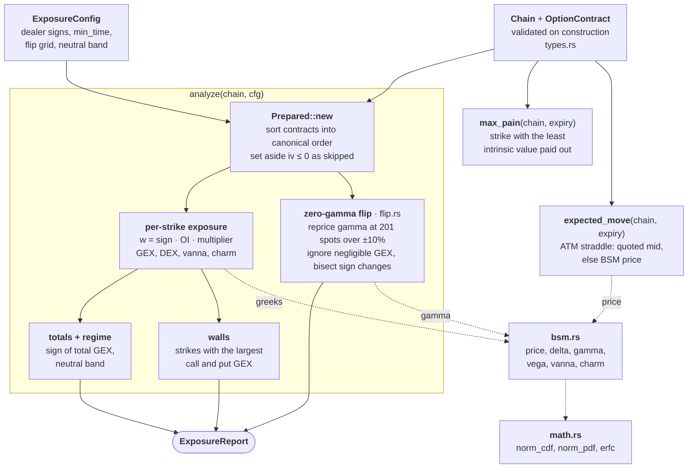
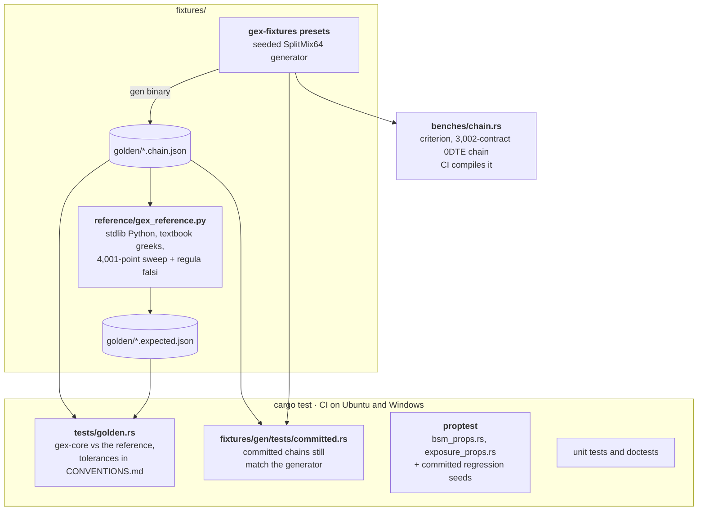

# gexkit

Options dealer-exposure analytics in Rust: Black-Scholes-Merton greeks,
GEX/DEX/vanna/charm by strike, zero-gamma flip, call/put walls, max pain and
expected move. Light on dependencies and checked against a Python reference.

**Status:** Phase 1. The workspace contains only the `gex-core` library and
its test fixtures. Data providers, a CLI and an MCP server are planned.

## Example

```rust
use gex_core::{Chain, ExposureConfig, GexError, OptionContract, OptionKind, analyze, max_pain};

fn main() -> Result<(), GexError> {
    let week = 7.0 / 365.0;
    let chain = Chain::new(100.0, 0.045, 0.0, vec![
        OptionContract::new(OptionKind::Put, 95.0, week, 0.25, 2_000)?,
        OptionContract::new(OptionKind::Call, 100.0, week, 0.21, 1_200)?,
        OptionContract::new(OptionKind::Put, 100.0, week, 0.22, 900)?,
        OptionContract::new(OptionKind::Call, 105.0, week, 0.20, 1_500)?,
    ])?;

    let report = analyze(&chain, &ExposureConfig::default())?;
    println!("total GEX ${:.0} per 1% move, {:?}", report.total_gex, report.regime);
    println!("flip {:?}", report.zero_gamma.map(|z| z.level));
    println!("walls {:?}, max pain {}", report.walls, max_pain(&chain, week)?);
    Ok(())
}
```

## What it computes

| Function | Output |
|---|---|
| `bsm::greeks` | price, delta, gamma, vega, vanna, charm for one option |
| `analyze` | per-strike and total GEX, DEX, vanna and charm exposure; regime; zero-gamma flip; walls |
| `zero_gamma` | every spot on the grid where total GEX changes sign, refined by bisection |
| `max_pain` | settlement strike that minimises the intrinsic value paid out, per expiry |
| `expected_move` | ATM straddle and the range it implies, per expiry |

Units, signs and tie-breaking rules are in
[docs/CONVENTIONS.md](docs/CONVENTIONS.md). In short: GEX is dollar gamma per
1% move, dealers are assumed long calls and short puts, vanna exposure is per
vol point and charm exposure per calendar day.

## Architecture

### How a chain becomes a report



`analyze` is the main entry point. `max_pain` and `expected_move` work on
one expiry at a time. The dotted arrows show which model functions each step
calls. Every exposure step uses time to expiry floored at `min_time`, and
the levels use the raw time to expiry.

### How the numbers are checked



The golden files are committed, so CI doesn't need Python. They are
regenerated by hand, with the two commands under Testing, only when a
convention or preset changes on purpose. The Python reference shares the
conventions with `gex-core` but none of its code or algorithms.

## Testing

- **Golden tests.** `fixtures/gen` generates deterministic synthetic chains
  (0DTE index, multi-expiry ETF, put-heavy negative gamma, edge cases), and
  `fixtures/reference/gex_reference.py` recomputes everything using only
  Python's standard library. It shares the conventions (units, signs, tie
  rules, the negligible-GEX threshold) but not the methods: greeks come from
  the textbook formulas and `math.erfc`, and the flip comes from a
  4,001-point sweep with regula falsi rather than the 201-point grid with
  bisection. `gex-core` must match to within the tolerances in
  CONVENTIONS.md.
- **Property tests.** Put-call parity, delta parity, price bounds and
  monotonicity, finite-difference checks of every greek, no NaN on any valid
  input. For the engine: results don't depend on input order, exposures
  scale with open interest and add across chains, the reported flip
  crossings are exactly the sign changes of non-negligible GEX on an
  independent sweep of the grid (none for one-sided chains), max pain beats
  brute force.
- **Benchmarks.** `cargo bench -p gex-core` runs on a 3,002-contract 0DTE
  chain. First run, Windows, release build:

  | Bench | Time |
  |---|---|
  | greeks, one contract | 42 ns |
  | per-strike exposure | 0.26 ms |
  | zero-gamma sweep | 14 ms |
  | max pain | 5.3 ms |
  | expected move | 0.02 ms |
  | full `analyze` | 14 ms |

Regenerate the fixtures only when a convention or preset changes on purpose:

```bash
cargo run -p gex-fixtures --bin gen -- fixtures/golden
py -3 -I fixtures/reference/gex_reference.py fixtures/golden
```

## Limitations

These numbers rest on modelling assumptions. Treat them as estimates of
dealer positioning, not measurements of it.

- **Dealer positioning is assumed, not observed.** The default "dealers long
  calls, short puts" is a convention. Real dealer books differ, especially
  with heavy call buying or put selling. Signs are configurable, but no
  per-trade direction is used.
- **Open interest is stale intraday.** OI is normally published once a day,
  so 0DTE positions opened today are missing. Volume is stored but not used.
- **European BSM only.** Early exercise for American options (most single
  stocks and ETFs) is ignored, and dividends are a continuous yield, not
  discrete payments.
- **Sticky-strike flip.** The zero-gamma sweep moves spot with each
  contract's IV fixed and time frozen. It does not model skew moving with
  spot or the passage of time. Two crossings inside one grid cell cancel and
  are missed, and crossings beyond ±10% of spot are not searched by default.
- **Near-expiry gamma depends on a time floor.** Exposures use at least one
  minute to expiry. ATM gamma on expiring contracts is therefore large but
  finite, and the floor is a modelling choice.
- **Missing or bad IV.** Contracts with `iv <= 0` are skipped, not
  re-implied from quotes, and IV is not checked for plausibility.
- **Expected move is a straddle.** It is the raw ATM straddle at the nearest
  listed strike, with no interpolation between strikes. Its accuracy depends
  on how good the quotes are: mids of wide markets are unreliable.
- **Max pain** uses listed strikes as settlement candidates and costs
  O(strikes × contracts) per expiry.
- **Synthetic fixtures.** The golden chains test arithmetic agreement with
  an independent implementation, not the accuracy of the model against
  market data.
- **Not financial advice.** This is analytics code, not a trading signal.

## License

Licensed under either of [Apache License 2.0](LICENSE-APACHE) or
[MIT license](LICENSE-MIT) at your option.
